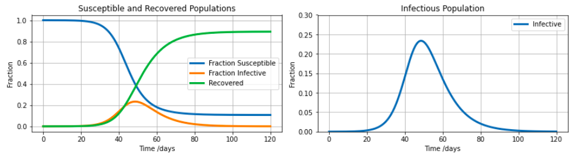
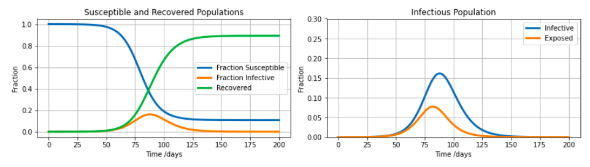
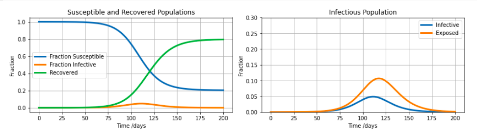
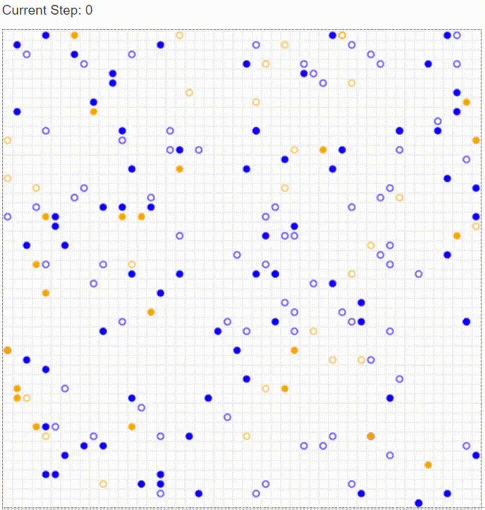
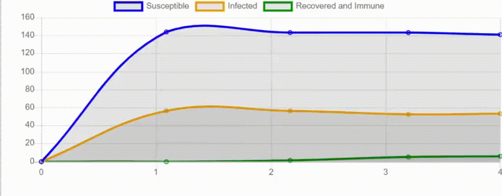

# Modelling the Spread of COVID-19: SIR, SEIR and Agent-Based Simulation

Compartmental and agent-based models of an epidemic in a population of 22,000, starting from a single case. The ODE models show how incubation and social distancing reshape the curve; the agent-based model shows the same dynamics emerging from individual movement, masking and waning immunity.

**Stack:** Python · SciPy (`odeint`) · NumPy · Matplotlib · Mesa

---

## Shared parameters

| Parameter | Value | Meaning |
|---|---|---|
| R<sub>0</sub> | 2.5 | Basic reproduction number, β / γ |
| Infective period | 7 days | γ = 1/7 |
| Incubation period | 3 days | α = 1/3 (SEIR models) |
| Initial cases | 1 / 22,000 | One infected (or exposed) person |

All three ODE models work in population fractions (s + i + r = 1, or s + e + i + r = 1) and are integrated with `scipy.integrate.odeint`.

## Model 1: SIR

The population splits into **Susceptible**, **Infectious** and **Recovered**:

```
ds/dt = -β s i
di/dt =  β s i - γ i
dr/dt =  γ i
```

β is the transmission rate and γ the recovery rate.



## Model 2: SEIR

Adds an **Exposed** compartment for people who are infected but not yet infectious, which delays and flattens the peak relative to SIR:

```
ds/dt = -β s i
de/dt =  β s i - α e
di/dt =  α e - γ i
dr/dt =  γ i
```



## Model 3: SEIR with control

Social distancing and other interventions are modeled as a control parameter *u* that scales down transmission, from u = 0 (no control) to u = 1 (complete isolation of infectious people). The plotted run uses **u = 0.2**:

```
ds/dt = -(1 - u) β s i
de/dt =  (1 - u) β s i - α e
```

Comparing Models 2 and 3 shows how much a partial reduction in contact lowers and delays the peak.



## Agent-based simulation (Mesa)

The ODE models assume a perfectly mixed population. The agent-based model (`model.py`, `model_visualization.py`) drops that assumption: agents live on a **50 x 50 grid** and infection spreads only through contact.

- A fixed number of agents start in random cells; at each step, each agent stays put or moves to an adjacent cell.
- A set fraction of agents are **masked** (default 50%).
- A susceptible agent sharing a cell with an infected one is infected with a probability that depends on masking (defaults: **0.25** masked, **0.75** unmasked).
- Infected agents recover after a set number of steps and become immune; **immunity wanes** after a further set number of steps, returning them to susceptible.

Every parameter is a slider in Mesa's browser UI. Agents are drawn blue (susceptible), orange (infected) or green (recovered); filled circles are masked.

| Simulation | S / I / R over time |
|---|---|
|  |  |

## Running it

```bash
pip install numpy scipy matplotlib mesa
jupyter notebook "SIR Modelling of spread of COVID-19.ipynb"   # ODE models
python model_visualization.py                                   # agent-based model in the browser
```

The agent-based model uses Mesa's older visualization API (`UserSettableParameter`), so it needs a pre-1.0 Mesa release.

## Repository layout

```
SIR Modelling of spread of COVID-19.ipynb   SIR, SEIR and SEIR-with-control models
model.py                                    Mesa agents and model
model_visualization.py                      grid, chart and sliders for the browser UI
Graphs/ · GIFs/                             figures and simulation recordings
```

## Limitations

- The ODE models assume homogeneous mixing and fixed parameters; R<sub>0</sub>, incubation and infective periods are illustrative, not fitted to data.
- Control *u* is constant over time, rather than switching on at a threshold or decaying.
